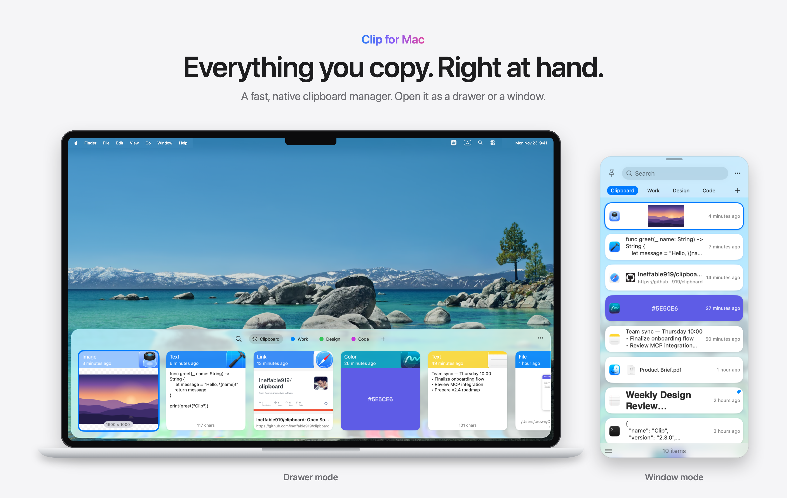

<p align="center">
    <div align="center"></div>
    <h2 align="center">Clipboard</h2>
    <div align="center">A macOS clipboard manager that helps you manage and use your clipboard history more efficiently.
</div>
    <div align="center"><strong>English</strong> | <a href="https://github.com/Ineffable919/clipboard/blob/master/README_ZH.md">中文</a></div>
</p>


## Download

Download the latest version from [Releases](https://github.com/Ineffable919/clipboard/releases/latest)


## Features

- **Real-time Clipboard Monitoring**: Automatically captures the text, rich text, images, files, links, and colors you copy
- **Two Display Modes**: Drawer mode at the bottom of the screen, or Window mode with an optional Compact layout that opens at the center of the screen, at the mouse position, or at its last position
- **Tags & Filters**: Custom tags (double-click to rename), multi-tag filtering, and filters by type, source app, or date
- **Quick Search**: Keyword search with highlighting, including text recognized in images (OCR); in Drawer mode, type `@image`, `@file`, etc. to filter by type
- **Preview & Edit**: Press `Space` to preview, with Markdown rendering; edit text in place, or use the JSON editor (formatting, minifying, escaping, Unicode encoding/decoding, key sorting, naming style conversion, folding, and syntax highlighting)
- **Multi-select**: Select multiple items to paste, copy, drag, or delete them together
- **Drag & Drop**: Drag items out to other apps, drag content in to save it, and reorder items by dragging in Drawer mode
- **Privacy**: Pause recording (the menu bar icon changes while paused), ignore specific apps, skip sensitive/transient content, and hide the window during screen sharing
- **History Management**: Configurable retention period, plus backup and import
- **MCP Server**: Built-in local MCP server so AI clients can search, read, save, edit, tag, and delete clipboard history (custom port supported)
- **Modern Interface**: Card-based UI built with AppKit, with light and dark appearances; the language follows the system by default

## System Requirements

- macOS 14.0 or later (compatible with macOS 26 and 27)
- Supports Apple Silicon (arm64) and Intel (x86_64) architectures

## How to Use

1. Copy any content normally (text, images, files, etc.)
2. Press `⌘ + ⇧ + V` (customizable) to open Clipboard
3. Work with your history:
   - Double-click an item, or select it and press `↩`, to paste directly
   - Press `Space` to preview an item
   - Use arrow keys to navigate (`← →` in Drawer mode, `↑ ↓` in Window mode)
   - In Drawer mode, scroll the mouse wheel to scroll horizontally
   - Start typing to search
   - Right-click an item for more actions

## Keyboard Shortcuts

| Shortcut | Action |
| --- | --- |
| `⌘ + ⇧ + V` | Open / close Clipboard (global, customizable) |
| `Esc` | Close the preview or search, or close the window |
| `← →` / `↑ ↓` | Move between items |
| `⌘ + ← →` | Switch to previous / next tag (customizable) |
| `Space` | Preview the selected item |
| `↩` | Paste the selected item(s) |
| `⇧ + ↩` | Paste as plain text (modifier customizable) |
| `⌘ + 1…9` | Quick paste the first 9 items (modifier customizable) |
| `⌘ + F` | Search; press again to toggle filters (Drawer mode) |
| `⌘ + C` | Copy the selected item(s) to the clipboard |
| `⌘ + E` | Edit the selected item |
| `⌘ + A` | Select all |
| `Delete` | Delete the selected item(s) |

## MCP

Enable the MCP server in Settings → AI. It runs locally at `http://127.0.0.1:38417/mcp` (Streamable HTTP, loopback only; the port can be changed), and the settings page provides setup guides for Claude Desktop, Claude Code, VS Code, Codex, and Cursor.

Available tools: `search_clipboard`, `read_item`, `copy_item`, `write_clipboard`, `save_item`, `update_item`, `delete_items`, `list_tags`, `create_tag`, `rename_tag`, `delete_tag`, `set_item_tag`.

## FAQ

### App won't open?

1. In System Settings → Privacy & Security, check the "Allow applications from" setting.
2. Try the following commands:
```sh
sudo xattr -r -d com.apple.quarantine /Applications/Clipboard.app
sudo codesign --force --deep --sign - /Applications/Clipboard.app
```

## License

This project is licensed under the [PolyForm Noncommercial License 1.0.0](https://polyformproject.org/licenses/noncommercial/1.0.0). See the [LICENSE](LICENSE) file for details.

- Commercial use is **not** allowed.
- Forks, modifications, and redistributions must keep the `Required Notice:` line in [LICENSE](LICENSE) (copyright and original repository: https://github.com/Ineffable919/clipboard) and include a copy of the license or its URL.
