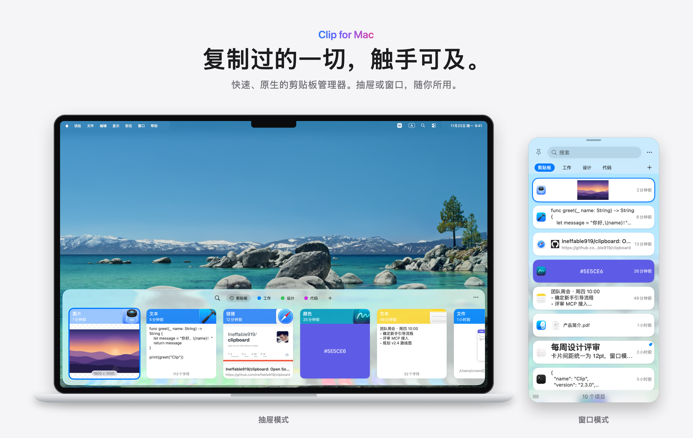

<p align="center">
    <div align="center"></div>
    <h2 align="center">Clipboard</h2>
    <div align="center">一款 macOS 剪贴板管理工具，帮助您更高效地管理和使用剪贴板历史记录。
</div>
    <div align="center"><a href="https://github.com/Ineffable919/clipboard/blob/master/README.md">English</a> | <strong>中文</strong></div>
</p>



## 下载

下载最新版本 [releases](https://github.com/Ineffable919/clipboard/releases/latest)

## 功能特性

- **实时监控剪贴板**：自动捕获并保存复制的文本、富文本、图片、文件、链接和颜色
- **两种显示模式**：屏幕底部的抽屉模式，或窗口模式（支持简洁显示），窗口可居中、跟随鼠标或记住上次位置
- **标签与筛选**：自定义标签（双击重命名），支持多标签筛选，以及按类型、来源应用、日期筛选
- **快速搜索**：关键词搜索并高亮，支持搜索图片中识别出的文字（OCR）；抽屉模式下输入 `@image`、`@文件` 等可按类型过滤
- **预览与编辑**：空格键预览，支持 Markdown 渲染；文本可直接编辑，并提供 JSON 编辑器（格式化、压缩、转义、Unicode 编解码、键排序、命名风格转换、折叠、语法高亮）
- **多选操作**：可多选历史记录后批量粘贴、复制、拖拽或删除
- **拖拽支持**：拖出内容到其他应用，拖入内容直接保存，抽屉模式支持拖拽调整顺序
- **隐私保护**：支持暂停记录（暂停时状态栏图标变化）、忽略指定应用、忽略敏感/临时内容、屏幕共享时隐藏窗口
- **历史管理**：可设置历史保留时长，支持数据备份与导入
- **MCP 服务**：内置本地 MCP 服务，AI 客户端可搜索、读取、保存、编辑、打标签和删除剪贴板历史（支持自定义端口）
- **现代界面**：基于 AppKit 的卡片式界面，适配浅深色外观，语言默认跟随系统

## 系统要求

- macOS 14.0 或更高版本（已适配 macOS 26、27）
- 支持 Apple Silicon (arm64) 和 Intel (x86_64) 架构

## 使用方法

1. 正常复制任何内容（文本、图片、文件等）
2. 按 `⌘ + ⇧ + V`（可自定义）打开 Clipboard
3. 通过以下方式操作历史记录：
   - 双击项目，或选中后按 `↩` 直接粘贴
   - 按空格键预览内容
   - 使用方向键导航（抽屉模式 `← →`，窗口模式 `↑ ↓`）
   - 抽屉模式下直接用鼠标滚轮即可横向滚动
   - 直接输入文字即可开始搜索
   - 右键点击项目打开菜单进行更多操作

## 键盘快捷键

| 快捷键 | 功能 |
| --- | --- |
| `⌘ + ⇧ + V` | 打开 / 关闭 Clipboard（全局，可自定义） |
| `Esc` | 关闭预览 / 搜索，或关闭窗口 |
| `← →` / `↑ ↓` | 在历史记录间导航 |
| `⌘ + ← →` | 切换到上一个 / 下一个标签（可自定义） |
| `空格` | 预览选中的项目 |
| `↩` | 粘贴选中的项目 |
| `⇧ + ↩` | 粘贴为纯文本（修饰键可自定义） |
| `⌘ + 1…9` | 快速粘贴前 9 条记录（修饰键可自定义） |
| `⌘ + F` | 搜索；再次按下切换筛选（抽屉模式） |
| `⌘ + C` | 复制选中的项目到剪贴板 |
| `⌘ + E` | 编辑选中的项目 |
| `⌘ + A` | 全选 |
| `Delete` | 删除选中的项目 |

## MCP

在 设置 → AI 中开启 MCP 服务。服务运行在本地 `http://127.0.0.1:38417/mcp`（Streamable HTTP，仅监听本机，端口可修改），设置页提供 Claude Desktop、Claude Code、VS Code、Codex、Cursor 的接入配置。

可用工具：`search_clipboard`、`read_item`、`copy_item`、`write_clipboard`、`save_item`、`update_item`、`delete_items`、`list_tags`、`create_tag`、`rename_tag`、`delete_tag`、`set_item_tag`。

## FAQ

### 应用打不开？

1. 检查系统设置 → 隐私与安全性 →“允许以下来源的应用程序”。
2. 试试以下命令：
```sh
sudo xattr -r -d com.apple.quarantine /Applications/Clipboard.app
sudo codesign --force --deep --sign - /Applications/Clipboard.app
```

## 许可证

本项目采用 [PolyForm Noncommercial License 1.0.0](https://polyformproject.org/licenses/noncommercial/1.0.0)（PolyForm 非商业许可证），详见 [LICENSE](LICENSE)。

- **禁止商用**。
- 二次开发、修改或再分发时，必须保留 [LICENSE](LICENSE) 中的 `Required Notice:` 行（版权与原项目地址：https://github.com/Ineffable919/clipboard），并附带许可证副本或其链接。
